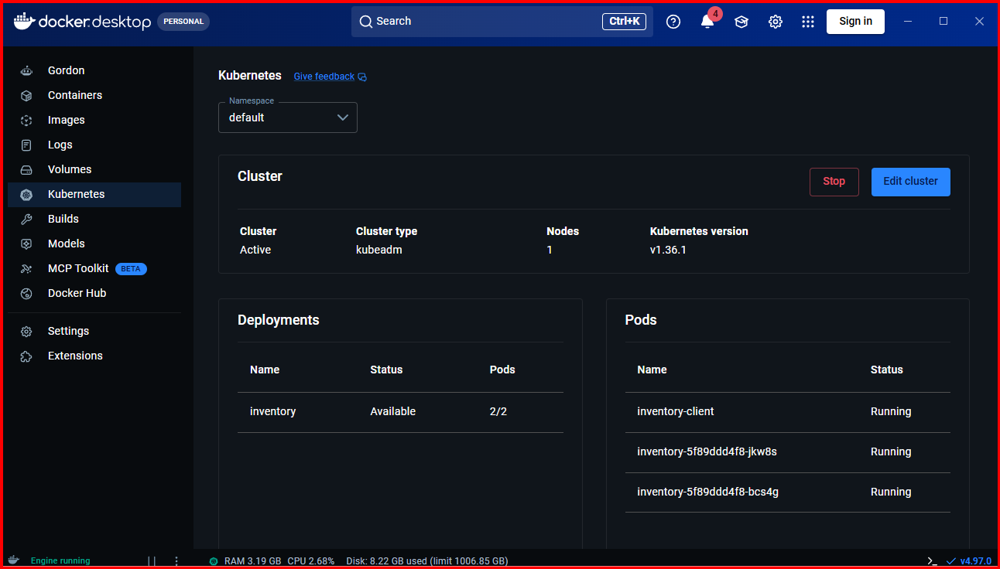
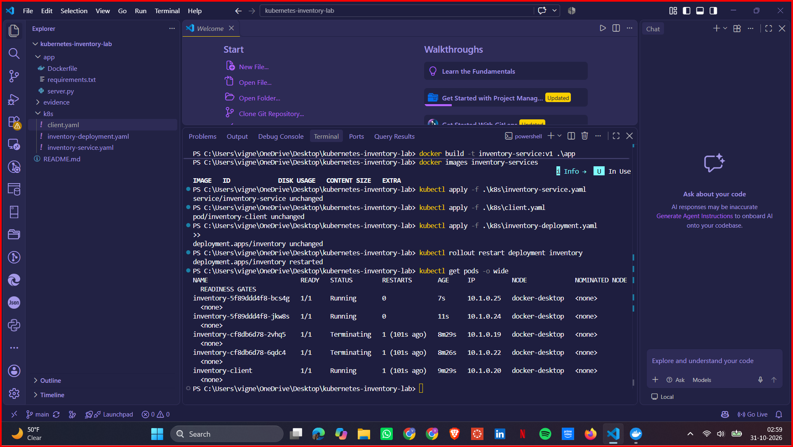
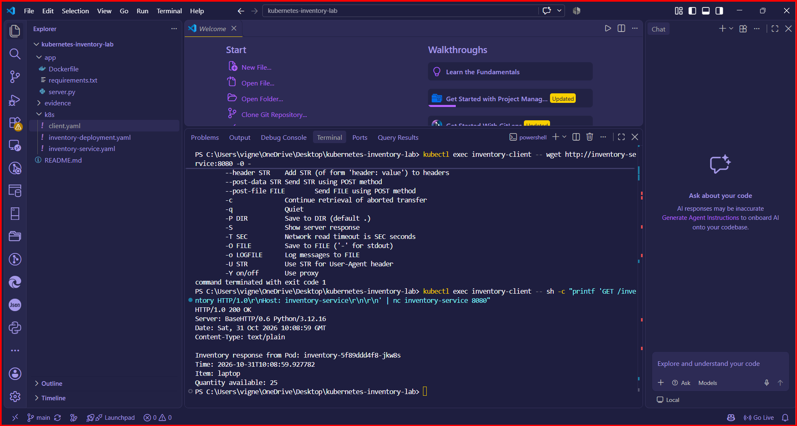
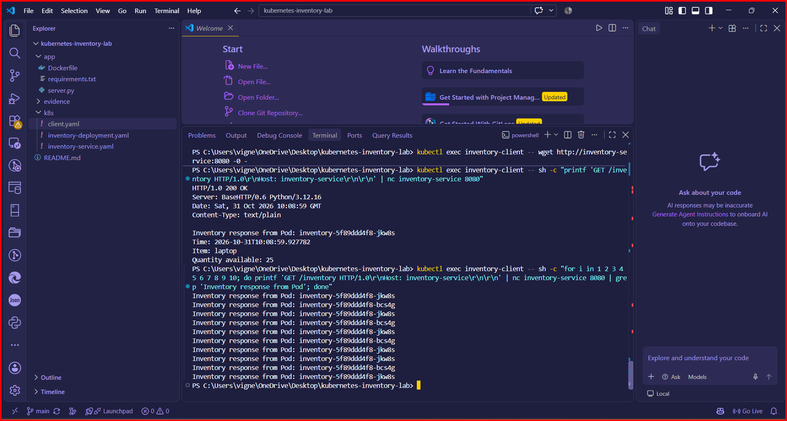
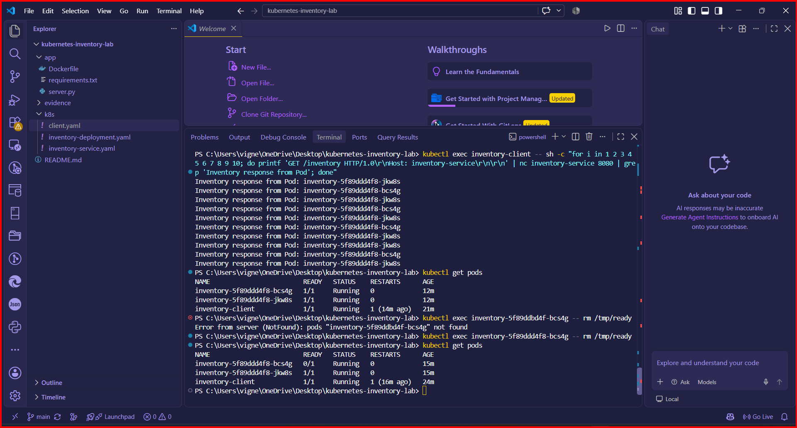
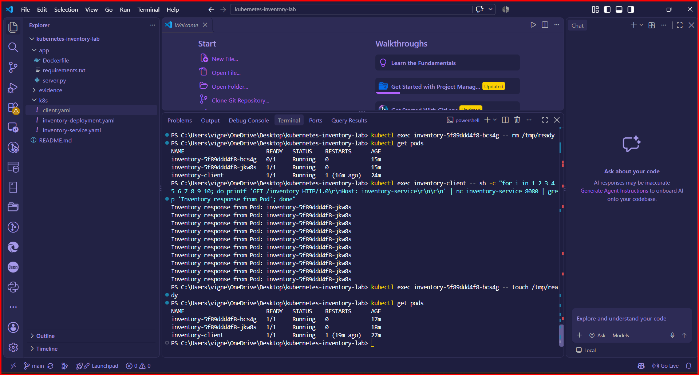
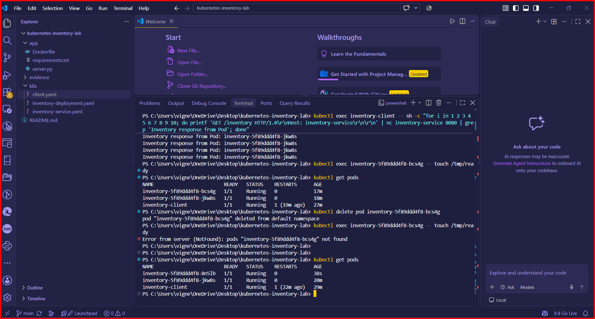
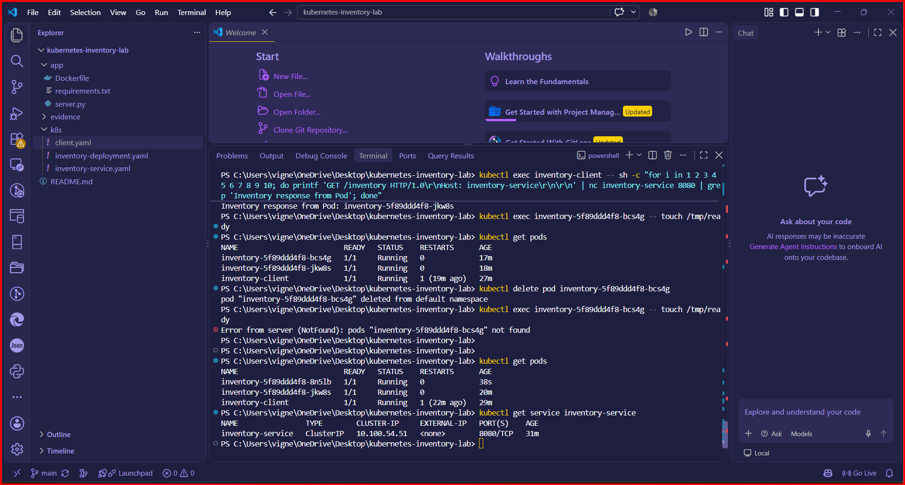
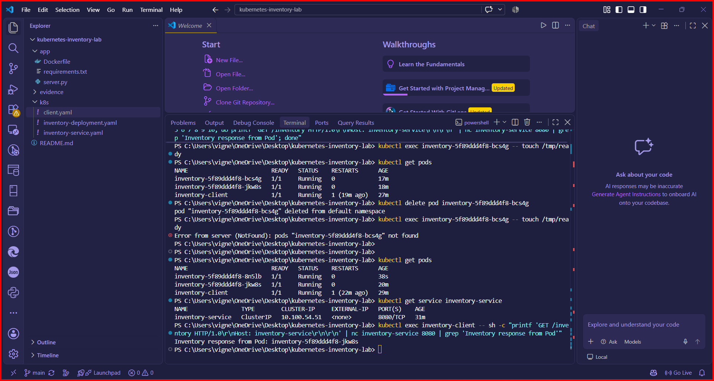

# Kubernetes Inventory Service Lab

## Overview

This project demonstrates Kubernetes **service discovery, load balancing, readiness probes, traffic management, and automatic Pod replacement** using a small Inventory application.

The application consists of:

- An **Inventory Deployment** with 2 replicas
- An **Inventory Service** that provides a stable Kubernetes Service name
- An **Inventory Client Pod** that sends requests to the Inventory Service
- A **readiness probe** that determines whether an Inventory Pod should receive Service traffic
- Kubernetes self-healing that automatically replaces a deleted Inventory Pod

The lab was implemented using **Docker Desktop Kubernetes**.

---

## Architecture

```text
                     Docker Desktop Kubernetes
+---------------------------------------------------------+
|                                                         |
|                   inventory-client                      |
|                          |                              |
|                          | HTTP                         |
|                          | inventory-service:8080       |
|                          v                              |
|                +---------------------+                  |
|                |  inventory-service  |                  |
|                |     ClusterIP       |                  |
|                +----------+----------+                  |
|                           |                             |
|                    Service Routing                      |
|                     /           \                       |
|                    v             v                      |
|          +---------------+   +---------------+          |
|          | Inventory Pod |   | Inventory Pod |          |
|          |   Replica 1   |   |   Replica 2   |          |
|          +---------------+   +---------------+          |
|                                                         |
|             Inventory Deployment                        |
|                  replicas: 2                            |
+---------------------------------------------------------+
```

The client communicates with `inventory-service` instead of communicating directly with individual Pod IP addresses.

---

## Technologies Used

- Docker Desktop
- Docker Desktop Kubernetes
- kubectl
- Python
- Kubernetes Deployments
- Kubernetes Services
- Kubernetes readiness probes
- BusyBox client container

---

## Project Structure

```text
kubernetes-inventory-lab/
│
├── app/
│   ├──Dockerfile
│   ├── requirements.txt
│   ├──server.py
│
├── k8s/
│   ├── inventory-deployment.yaml
│   ├── inventory-service.yaml
│   └── client.yaml
│
├── evidence/
│   ├── 01-docker-kubernetes-pods-running.png
│   ├── 02-two-inventory-replicas-running.png
│   ├── 03-service-name-communication.png
│   ├── 04-traffic-reaches-both-replicas.png
│   ├── 05-readiness-failure.png
│   ├── 06-unready-pod-removed-from-traffic.png
│   ├── 07-readiness-restored.png
│   ├── 08-pod-deletion-and-replacement.png
│   └── 09-service-unchanged-after-replacement.png
│
└── README.md
```

---

# 1. Build the Inventory Application

The Inventory application is packaged into a Docker image named:

```text
inventory-service:v1
```

From the project root, build the image using:

```powershell
docker build -t inventory-service:v1 .\app
```

Verify the image:

```powershell
docker images inventory-service
```

---

# 2. Deploy the Application

The Kubernetes manifests are stored inside the `k8s` directory.

### Create the Inventory Service

```powershell
kubectl apply -f .\k8s\inventory-service.yaml
```

### Create the Inventory Deployment

```powershell
kubectl apply -f .\k8s\inventory-deployment.yaml
```

### Create the Client Pod

```powershell
kubectl apply -f .\k8s\client.yaml
```

Verify the resources:

```powershell
kubectl get pods -o wide
```

---

# 3. Two Inventory Replicas

The Inventory Deployment is configured with:

```yaml
replicas: 2
```

Kubernetes therefore maintains two instances of the Inventory application.

The running resources were verified using:

```powershell
kubectl get pods -o wide
```

Both Inventory Pods reached:

```text
READY   STATUS
1/1     Running
1/1     Running
```

The `inventory-client` Pod was also running.

## Evidence

The following screenshot shows Docker Desktop Kubernetes running the Inventory Deployment and client:



The following screenshot confirms that both Inventory replicas are `1/1 Running`:



This satisfies the requirement to deploy **two Inventory replicas**.

---

# 4. Kubernetes Service Discovery

The Inventory Pods are exposed through a Kubernetes Service named:

```text
inventory-service
```

The client communicates with this Service instead of using an individual Inventory Pod IP address.

The application is accessed internally using:

```text
inventory-service:8080
```

and the Inventory endpoint is:

```text
/inventory
```

The following request was executed from the client:

```powershell
kubectl exec inventory-client -- sh -c "printf 'GET /inventory HTTP/1.0\r\nHost: inventory-service\r\n\r\n' | nc inventory-service 8080"
```

The request returned:

```text
HTTP/1.0 200 OK
```

along with the Inventory response and the hostname of the Pod that processed the request.

## Evidence



This demonstrates that the client successfully communicates using the Kubernetes Service name **`inventory-service`**, rather than an individual Pod address.

---

# 5. Requests Reach Multiple Replicas

The Inventory application returns the hostname of the Pod processing each request.

This allows the Kubernetes Service routing behavior to be observed directly.

Ten requests were sent through `inventory-service`:

```powershell
kubectl exec inventory-client -- sh -c "for i in 1 2 3 4 5 6 7 8 9 10; do printf 'GET /inventory HTTP/1.0\r\nHost: inventory-service\r\n\r\n' | nc inventory-service 8080 | grep 'Inventory response from Pod'; done"
```

The output contained **two different Inventory Pod names**, demonstrating that requests sent through the Service can reach more than one replica.

## Evidence



This demonstrates:

- The client communicates through `inventory-service`
- Multiple Inventory replicas are available behind the Service
- Requests can reach more than one Inventory replica

---

# 6. Readiness Probe

The Inventory Deployment includes a readiness probe.

The readiness probe checks whether the Inventory application is currently ready to receive normal Service traffic.

A healthy Inventory Pod appears as:

```text
1/1 Running
```

A Pod that fails its readiness probe can remain running while becoming:

```text
0/1 Running
```

This allows Kubernetes to temporarily remove a Pod from Service traffic without terminating the container.

---

# 7. Readiness Failure Test

To demonstrate readiness behavior, one Inventory Pod was intentionally made unready.

The Inventory application's `/health` endpoint checks for the existence of:

```text
/tmp/ready
```

The readiness file was removed from one Pod:

```powershell
kubectl exec <inventory-pod-name> -- rm /tmp/ready
```

After waiting for the readiness probe to detect the change:

```powershell
kubectl get pods
```

showed one Inventory Pod as:

```text
0/1 Running
```

while the other Inventory Pod remained:

```text
1/1 Running
```

## Evidence



This is important because the failed Pod is **still running**, but Kubernetes no longer considers it ready to receive normal traffic.

---

# 8. Unready Pod Stops Receiving Traffic

After one Pod became unready, another set of requests was sent through the Kubernetes Service:

```powershell
kubectl exec inventory-client -- sh -c "for i in 1 2 3 4 5 6 7 8 9 10; do printf 'GET /inventory HTTP/1.0\r\nHost: inventory-service\r\n\r\n' | nc inventory-service 8080 | grep 'Inventory response from Pod'; done"
```

All requests were handled by the **remaining ready Inventory Pod**.

The Pod that was `0/1` did not appear in the responses.

## Evidence



This demonstrates that:

- The unready Pod remained running
- The unready Pod stopped receiving normal Service traffic
- The second ready Pod continued serving requests
- The Inventory Service remained available

---

# 9. Restore Readiness

Readiness was restored by recreating `/tmp/ready` inside the previously unready Pod:

```powershell
kubectl exec <inventory-pod-name> -- touch /tmp/ready
```

After allowing the readiness probe to run again:

```powershell
kubectl get pods
```

showed both Inventory Pods as:

```text
1/1 Running
```

## Evidence



The previously unready Pod returned to the ready state and became eligible to receive Service traffic again.

This completes the readiness test by demonstrating both **readiness failure and recovery**.

---

# 10. Pod Failure and Automatic Recovery

Kubernetes Deployments maintain the desired number of replicas.

The Inventory Deployment specifies:

```yaml
replicas: 2
```

To demonstrate Pod failure and recovery, one Inventory Pod was manually deleted:

```powershell
kubectl delete pod <inventory-pod-name>
```

Kubernetes detected that the Deployment had fewer than two replicas and automatically created a replacement Pod.

The Pods were checked using:

```powershell
kubectl get pods
```

The replacement Inventory Pod had a **different Pod name/identity** from the deleted Pod.

## Evidence



This demonstrates:

- An Inventory Pod was manually deleted
- Kubernetes detected the missing replica
- Kubernetes automatically created a replacement
- The replacement received a different Pod identity/name
- The Deployment returned to two running Inventory replicas

---

# 11. Service Remains Stable After Pod Replacement

Although an Inventory Pod was deleted and replaced, the Kubernetes Service remained unchanged.

The Service was verified using:

```powershell
kubectl get service inventory-service
```

The Service remained:

```text
inventory-service
```

The client then sent another request using the same Service:

```powershell
kubectl exec inventory-client -- sh -c "printf 'GET /inventory HTTP/1.0\r\nHost: inventory-service\r\n\r\n' | nc inventory-service 8080 | grep 'Inventory response from Pod'"
```

The request successfully returned an Inventory response.

## Evidence



This demonstrates that:

- The Service name remained unchanged
- The client did not need to know the new Pod name
- The client continued communicating through `inventory-service`
- Pod replacement did not require changes to the client

---

# 12. Kubernetes Self-Healing

The Pod deletion experiment demonstrates Kubernetes self-healing.

The desired state of the Inventory Deployment is:

```text
Desired replicas: 2
```

When one Pod was deleted, the actual number of replicas temporarily became:

```text
Actual replicas: 1
```

The Deployment controller detected the difference and automatically created another Pod until the desired state was restored:

```text
Desired replicas: 2
Actual replicas: 2
```

The replacement Pod had a new identity, while the Inventory Service remained stable.

---

# Assignment Requirements

## 1. Deploy the Application

- [x] Inventory Deployment created
- [x] Deployment configured with 2 replicas
- [x] Both Inventory Pods running
- [x] Kubernetes Service exposes the Inventory replicas
- [x] Client Pod created
- [x] Client communicates using `inventory-service`
- [x] Client does not depend on individual Pod IP addresses
- [x] Requests reach more than one Inventory replica

### Evidence

- `01-docker-kubernetes-pods-running.png`
- `02-two-inventory-replicas-running.png`
- `03-service-name-communication.png`
- `04-traffic-reaches-both-replicas.png`

---

## 2. Readiness Test

- [x] Readiness probe configured
- [x] One Inventory Pod intentionally fails readiness
- [x] Pod remains running while becoming `0/1`
- [x] Unready Pod stops receiving normal Service traffic
- [x] Other ready Pod continues serving requests
- [x] Readiness is restored
- [x] Pod returns to `1/1 Running`

### Evidence

- `05-readiness-failure.png`
- `06-unready-pod-removed-from-traffic.png`
- `07-readiness-restored.png`

---

## 3. Pod Failure and Recovery

- [x] One Inventory Pod manually deleted
- [x] Kubernetes automatically creates a replacement
- [x] Replacement Pod has a different identity/name
- [x] Desired replica count returns to 2
- [x] `inventory-service` remains unchanged
- [x] Client continues communicating through the same Service

### Evidence

- `08-pod-deletion-and-replacement.png`
- `09-service-unchanged-after-replacement.png`

---

# Useful Commands

### Check Kubernetes nodes

```powershell
kubectl get nodes
```

### Check Pods

```powershell
kubectl get pods
```

### Check detailed Pod information

```powershell
kubectl get pods -o wide
```

### Check Deployments

```powershell
kubectl get deployments
```

### Check Services

```powershell
kubectl get services
```

### Check the Inventory Service

```powershell
kubectl get service inventory-service
```

### Check Service endpoints

```powershell
kubectl get endpoints inventory-service
```

### Describe a Pod

```powershell
kubectl describe pod <pod-name>
```

### View Pod logs

```powershell
kubectl logs <pod-name>
```

---

# Key Concepts Demonstrated

## Service Discovery

Kubernetes provides internal DNS-based service discovery. The client accesses the Inventory application using:

```text
inventory-service
```

rather than tracking individual Inventory Pod IP addresses.

## Service Routing

The Kubernetes Service routes requests to available ready Inventory Pods. Requests in this lab were observed reaching both replicas.

## Readiness

Readiness probes determine whether a Pod should receive normal Service traffic.

A Pod can remain:

```text
Running
```

while being:

```text
0/1
```

and therefore not receive normal Service traffic.

## Self-Healing

The Deployment continuously maintains the desired number of Inventory replicas.

When an Inventory Pod was manually deleted, Kubernetes automatically created a replacement.

## Stable Service Endpoint

Pod names and IP addresses can change during replacement. The Kubernetes Service provides a stable endpoint that remains unchanged.

The client therefore continues using:

```text
inventory-service
```

regardless of which Inventory Pods currently exist.

---

# Conclusion

This lab demonstrates several fundamental Kubernetes behaviors using a two-replica Inventory application.

The Inventory Deployment successfully maintained two application replicas behind the `inventory-service` Kubernetes Service. The client communicated using the Service name rather than individual Pod addresses, and requests were observed reaching multiple replicas.

The readiness test demonstrated that an Inventory Pod can remain running while being marked unready. Kubernetes stopped routing normal Service traffic to the unready Pod while the other replica continued serving requests. After readiness was restored, the Pod returned to the ready state.

Finally, manually deleting an Inventory Pod demonstrated Kubernetes self-healing. Kubernetes automatically created a replacement Pod with a different identity while maintaining the desired replica count. The `inventory-service` Service remained unchanged, and the client continued communicating through the same stable Service endpoint.

Together, these tests demonstrate **Kubernetes service discovery, readiness-based traffic management, stable service networking, and automatic Pod recovery**.
